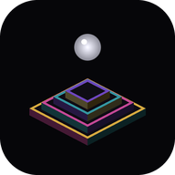

# Hopper



A puzzle for Android, seen from inside a drop of quicksilver. The drop never
stops bouncing; all you choose is where the next bounce goes. Below lies a black
liquid, and over it stand hopper crystals of bismuth: stepped, hollow, iridescent
islands, stacked into floors you can hop under, climb onto and fall from.

Each level begins in total black. A tap strikes the nothing, a ring runs out
over the liquid, and the level rises out of it.

## In the level

- **Shards** glow in the pits of the islands. Take them all and the gate opens:
  a turning ring with a column of light over it.
- **Glass** holds while you bounce on it, and sinks the moment you leave.
- **Springs** throw you two cells their own way, along the glowing arrow, and a
  floor up. They are the only way up.
- **Floors** float one over another. A hop off the edge lands on whatever lies
  below, or in the liquid. Under a floor you can still hop, but not leap or be
  thrown: the floor is a ceiling.
- **Hot plates** burn, and so does their heat if you leap over them, unless you
  carry a silver **bead**: it cools one plate.
- **Mirages** look like islands and hold nothing. The map does not show them.
  Over each stands a shimmering mirror, always turned to the drop, and in it the
  drop bounces as seen through hot air. Near a mirage, the island ahead answers
  every landing with a soft note; a mirage keeps silent.

Some levels **shift**. They come in acts: after a number of landings the ground
trembles for three bounces, then everything but the island under you goes down
into the liquid and a new act rises around you. Shards you did not reach move on
to the next act; the gate waits in the last one.

Rarer levels keep an **order**. Their shards must be taken one after another,
and the only clue is sound: near the drop each shard hums, the first one lowest
and slowest, each next one higher and quicker. Take one out of turn and its
island opens into a funnel down into a level you have already won; win that one
and the funnel pours you back.

The first ten levels are drawn by hand. Every level after them is grown from
its own number: a walk through the floors that obeys every rule becomes the way
through, so each level can be won, and a solver picks the grown candidate whose
shortest way fits the difficulty. Difficulty rises one step every three levels,
each step bringing one new thing, until it reaches a ceiling; every twentieth
level is a step easier, every thirtieth two. There is always a next level.

## Rivals

From the thirty-sixth level on, about one level in four brings a lilac drop
that races you to the gate; from the sixtieth, two. A rival has the same task
as you, every shard and then the gate, and plays about as well as a person
would: it hesitates, steps aside and back, now and then slips into the liquid
and drops in again from above at the start. It is seen and heard landing near
you, and shown on the map; once it has all its shards it burns brighter and two
bells ring. If it reaches the gate first, the level is lost and starts again.

## The world

Every level won for the first time grows a piece of a world out of the black,
in the dark before the next level. It starts as one crystal; the next ones grow
out of each other, and in time come glades, branches and trees, cubes, houses
with lit windows, whole streets and towers. Now and then, without warning,
something precious comes up: a burning gem, a funnel of light, a prism. The
world follows from the number of levels won alone, so it is always the same
world. A tap sends it under, and the level wakes.

## The watcher and the hopscotch

Beside the map sits the watcher: an eye in a stepped frame of bismuth. Tap it
and it works out the way, the level rises again, and the watcher plays it,
turning and hopping exactly as a finger would. Swipe, and the drop is yours
again.

After the watcher's game comes the hopscotch: every level as a chalked square,
the numbers climbing up the screen in pairs and singles. Any level played can
be played again, or the next one taken. Squares the watcher played carry its
mark. The system back button opens the hopscotch at any time; pressed there, it
leaves the game. Each level grows from its own number, so a level chosen again
is the very same level.

## Controls

- **Swipe up** — the next bounce goes one cell ahead.
- **Long swipe up** — a leap over a cell.
- **Swipe up and to a side** — one cell across a corner.
- **Swipe sideways** — turn by a quarter, at once.
- **Swipe down** — turn round.
- **Tap** — forget the order and look at the map.
- **Tap the eye** beside the map — the watcher plays the level.
- **Back** — the hopscotch of all levels.

The map in the corner turns with you: up is always ahead. It shows the floor you
are on in full, the floors below small and dim, the floors above as outlines,
and the cell your next bounce will land on.

## The black drop

The hundredth level is an arena drawn by hand: open ground, and in two corners a
slab of the floor above, each reached by a spring. It has no shards and no gate. Far beyond it stands a tall dark tower crowned with
fire; from its top a black drop leaps down into the arena
and comes for you by the same rules you hop by, keeping off glass and hot
plates. If it lands on your island it strikes: a slash runs across the
screen, a seam stays on your view, and the world is cut in two: the half without you tips over the edge into the black, and the islands
the cut went through show their steps in section, sawn and polished. A second
strike, and you are lost: the level starts again, whole. The only way through
is to come down on it from a floor above. Where you could reach it in one hop or
leap, it stops and looks up, its rim flaring: that is the moment.

The watcher can fight it for you, as everywhere else.

Beat it, and the world you grew turns to gold in a rose dawn. The game is won,
and the levels go on; from then on a little hopscotch stands between the map
and the eye. Tapped, it opens the open mode: every level, and behind the strip
the world as it stood at each number. Tapped again, it closes.

## Settings

Along the bottom of the hopscotch, three chalk buttons; a tap turns one over.

- **Sound** or **no sound**.
- **Watcher to 20** or **watcher to 100**: the levels the eye comes to, the black
  drop's included in the second.
- **Hard** or **easy**. Easy helps the finger: a hop ordered into the liquid,
  onto a mirage or a hot plate, or over one, is turned aside with a short
  warning tap: a leap becomes a hop, a slant a straight hop, or the drop bounces
  where it is; a spring that would throw it into the liquid only bounces it.

## The developer's mode

A long press on the hopscotch turns it on, with a run of bells upwards; another
turns it off, with the bells going down. While it is on, every level is open
and the strip scrolls fast; nothing won is written down; and the world in the
dark is as big as the level's number, so any level and any size of the world
can be looked at without playing up to it.

## Building

No IDE and no build system. The build tools of the Android SDK, a JDK and a
platform jar, API 34 or newer, are all it takes:

```sh
export ANDROID_JAR=/path/to/android.jar
export KEYSTORE=/path/to/your.keystore KEY_ALIAS=yourkey KS_PASS=yourpassword
./build.sh
```

The signed package is `out/hopper.apk`. It runs on Android 8.0 and newer with
OpenGL ES 3.0. Everything seen and heard is made by the code: the islands, the
liquid's waves, the light, the bells and knocks.

## License

0BSD. Do what you like with it.
